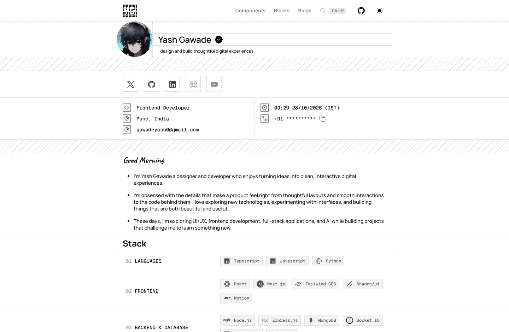

# yashgawade.com

Personal portfolio of **Yash Gawade**, a frontend and full-stack developer based in Pune, India.

<picture>
  <source media="(prefers-color-scheme: dark)" srcset="docs/preview-dark.png">
  
</picture>

The visual language (dashed rails, hatched dividers, a pixel-grid logo) is inspired by [Chanh Dai's portfolio](https://chanhdai.com). Both the light and the dark design were made in Figma and built from it section by section.

## What's inside

- **Home page**: profile, stack, experience, education and projects.
- **[/components](src/app/components)**: every small UI piece on the site with a live preview and its real source code.
- **[/blocks](src/app/blocks)**: whole page sections, built from those components.
- **[/blogs](src/app/blogs)**: posts written as plain MDX files.
- **Search menu**: press `Ctrl+K` (`⌘K` on Mac) to jump to any page, section, component, block or blog post, open links, or copy contact details. It is built from the same data files as the pages, so new content shows up on its own.
- **Light and dark themes**: follows the device setting by default. The header button (or the search menu) switches it, the choice is remembered, and there is no flash of the wrong theme on load. All colors are tokens in `src/app/globals.css`, written as `light-dark(<light>, <dark>)` pairs.
- **Greeting and clock** that follow the visitor's local time.
- **Masked phone number**: the real number is never in the page HTML. It is fetched from an API route only when someone clicks copy.
- **Responsive** down to 320px wide.

## Tech stack

| | |
| --- | --- |
| Framework | [Next.js](https://nextjs.org) 16 (App Router, Cache Components), React 19 |
| Language | TypeScript |
| Styling | Tailwind CSS 4, shadcn/ui (Base UI), design tokens in `src/app/globals.css` |
| Motion | [Motion](https://motion.dev) |
| Content | MDX via `@next/mdx` |
| Icons | Iconify sets, bundled at build time into `src/lib/icons.generated.ts` |
| Hosting | Built to deploy on Vercel |

## Getting started

You need Node.js 20.9 or newer.

```bash
git clone https://github.com/CodedByYash/yashgawade.com.git
cd yashgawade.com
npm ci
cp .env.example .env.local   # then set CONTACT_PHONE
npm run dev
```

Open [http://localhost:3000](http://localhost:3000).

### Environment variables

| Name | Purpose |
| --- | --- |
| `CONTACT_PHONE` | Phone number copied by the copy button. Without it the copy button has nothing to copy and the rest of the site works normally. Set it in your hosting provider's settings too. |

### Scripts

| Command | What it does |
| --- | --- |
| `npm run dev` | Start the dev server |
| `npm run build` | Production build |
| `npm run start` | Serve the production build |
| `npm run lint` | Run ESLint |
| `npm run typecheck` | Generate route types, then run the TypeScript compiler |
| `npm run gen:icons` | Regenerate the icon set after adding names in `scripts/gen-icons.mjs` |

`dev` and `build` also refresh the package versions shown in the footer.

## Project structure

```text
src/
  app/            Routes: home, /components, /blocks, /blogs and /api/phone
  components/     Reusable UI pieces, plus blocks/, registry/ and search/ helpers
  content/blogs/  Blog posts (.mdx)
  data/           Typed content: profile, stack, experience, education, projects
  lib/            Utilities, theme logic, blog loader, search index, source reader, generated icons
  registry/       The list of components and blocks shown on their pages
scripts/          Icon and version generators
docs/             README assets
```

## Editing content

- **Profile, stack, experience, education, projects**: edit the files in `src/data/`. No component changes needed.
- **New blog post**: add a file to `src/content/blogs/`. The file name becomes the URL.

  ```mdx
  export const meta = {
    title: "My post",
    description: "One line shown in the list.",
    date: "2026-10-18",
    tags: ["Next.js"],
  };

  Write the post here.
  ```

- **New component or block page**: add an entry to `src/registry/components.tsx` or `src/registry/blocks.tsx` with a slug, description, preview and the source files to display.

## Credits

Inspired by [Chanh Dai](https://chanhdai.com). Built with [Next.js](https://nextjs.org), [Tailwind CSS](https://tailwindcss.com), [shadcn/ui](https://ui.shadcn.com), and made to deploy on [Vercel](https://vercel.com).
